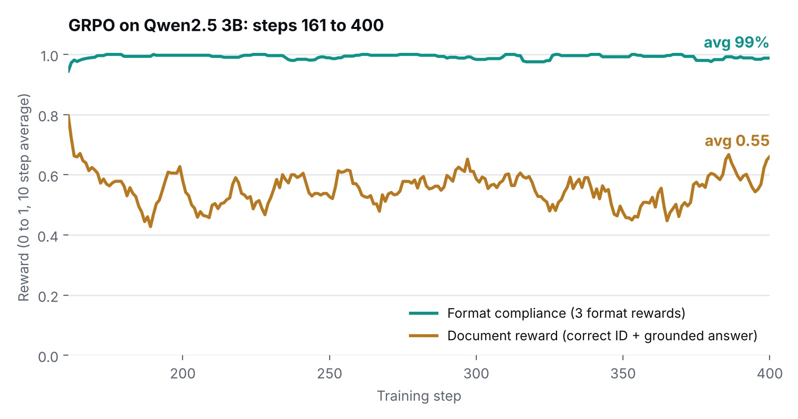

# GRPO for cited RAG answers · Qwen2.5 3B

Reinforcement learning fine tuning (GRPO) that teaches a small model to answer questions from retrieved documents **in a strict, machine readable format and to cite the document it used**.

The interesting part is the reward design: four small, rule based reward functions instead of a learned reward model, so training runs on a single free Colab T4.



## The output format

The model must reason, cite, then answer, with nothing else around it:

```text
<think> which document answers the question, and why </think>
<document id> 2 </document id>
<answer> the answer, grounded in document 2 </answer>
```

A strict format makes the answer easy to parse, and an explicit citation makes it easy to check.

## Rewards

GRPO samples 6 answers per question and scores each with the functions in [`rewards.py`](rewards.py). They are summed, so the maximum is **4.0**.

| Reward | What it checks | Score |
| --- | --- | --- |
| `document_id_accuracy` | Cited the correct document, and the answer overlaps with that document's text | 0.65 for the right ID, +0.35 if the answer is grounded (text similarity above 0.3) |
| `tag_existence` | All three tag pairs are present | 0.3 + 0.3 + 0.4 |
| `no_extra_text` | Nothing outside the three blocks | 0 or 1 |
| `tag_order` | Tags appear as think → document → answer | 0 or 1 |

Splitting format and correctness into separate rewards keeps the signal clear: the model gets credit for the parts it got right instead of an all or nothing score.

## Results

Logged training rewards for steps 161 to 400 (the run was resumed from the step 160 checkpoint), full log in [`results/training_log.csv`](results/training_log.csv):

| Metric | Average, steps 161 to 400 |
| --- | --- |
| Format compliance (mean of the three format rewards) | **99%** |
| Document reward (out of 1.0) | **0.55** |
| Total reward (out of 4.0) | **3.53** |

- **Format: learned and stable.** The model follows the think → cite → answer structure almost every time.
- **Citation quality: still the open problem.** The document reward stays around 0.55 without a clear upward trend, so this is where the next round of work should go.

These are training rewards, not scores on a held out test set.

## Setup

| | |
| --- | --- |
| Base model | `unsloth/Qwen2.5-3B-Instruct-bnb-4bit` (4 bit) |
| Method | GRPO with LoRA (rank 32, all attention and MLP projections, ~2% of weights trained) |
| Libraries | Unsloth, TRL 0.15.2, vLLM for fast generation |
| Training | 1,000 examples, lr 5e-6 with cosine schedule, 6 generations per prompt, 256 token answers |
| Hardware | 1 × Tesla T4 (free Colab) |

Checkpoints are published every 10 steps on Hugging Face: [faraya1/genie-grpo-test-RAG-Qwen3B-faraya](https://huggingface.co/faraya1/genie-grpo-test-RAG-Qwen3B-faraya).

## Run it

1. Open [`grpo_rag_citations_qwen3b.ipynb`](grpo_rag_citations_qwen3b.ipynb) in Colab with a GPU runtime.
2. Upload your data as `filtered_train_stratified.jsonl` (and optionally `filtered_test.jsonl`). Each line needs:
   - `prompt`: the chat messages as a JSON string (system instructions, question and retrieved documents)
   - `documents`: the list of retrieved document texts
   - `document_id`: the index of the document that answers the question
3. Log in to Hugging Face when prompted and run the cells in order. Checkpoints are pushed to your account as training goes.

The dataset used for these results is not included in this repository.

## Next steps

- Evaluate the base model and the step 400 checkpoint on the held out test split, to measure what GRPO actually changed.
- Rework the document reward: the fixed text similarity threshold is coarse, and a softer score should give the model a better signal.
- Try longer answers than 256 tokens and scale the same pipeline to Qwen3 8B.

## Repository

```text
grpo_rag_citations_qwen3b.ipynb   training notebook (Colab)
rewards.py                        the four reward functions
results/training_log.csv          per step rewards, KL and answer length
results/reward_curve.png          chart above
```

---

Built by [Faraya Baig](https://github.com/Farayabaig), AI Engineer working on agents, RAG and AI security.
